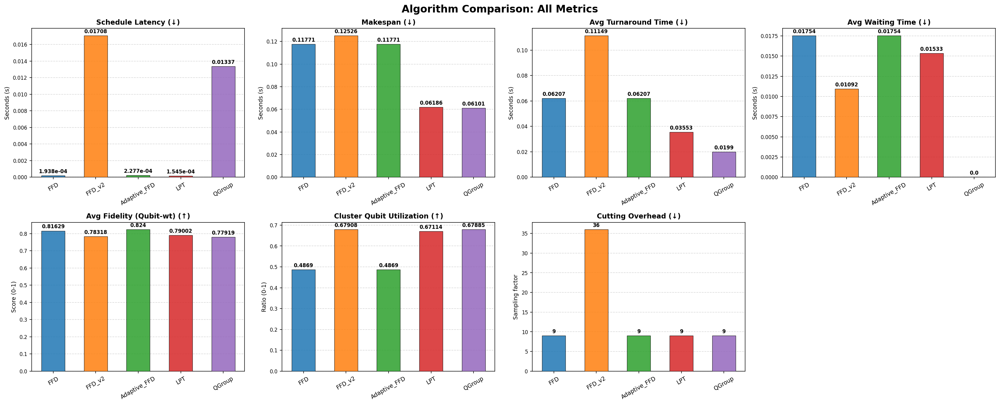
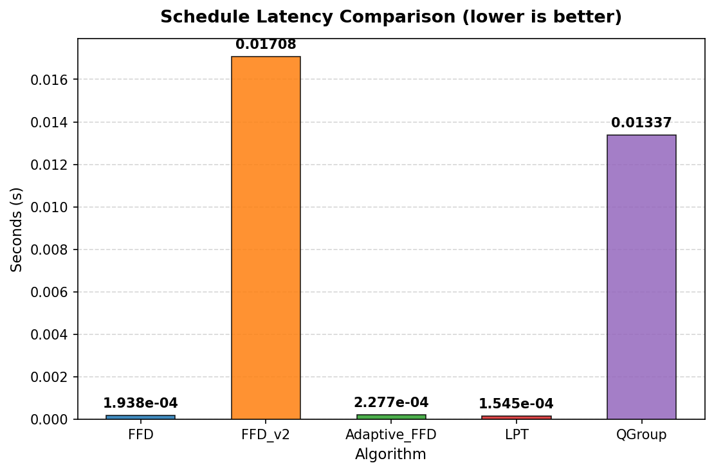
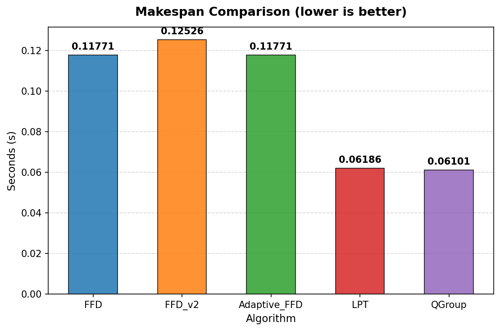
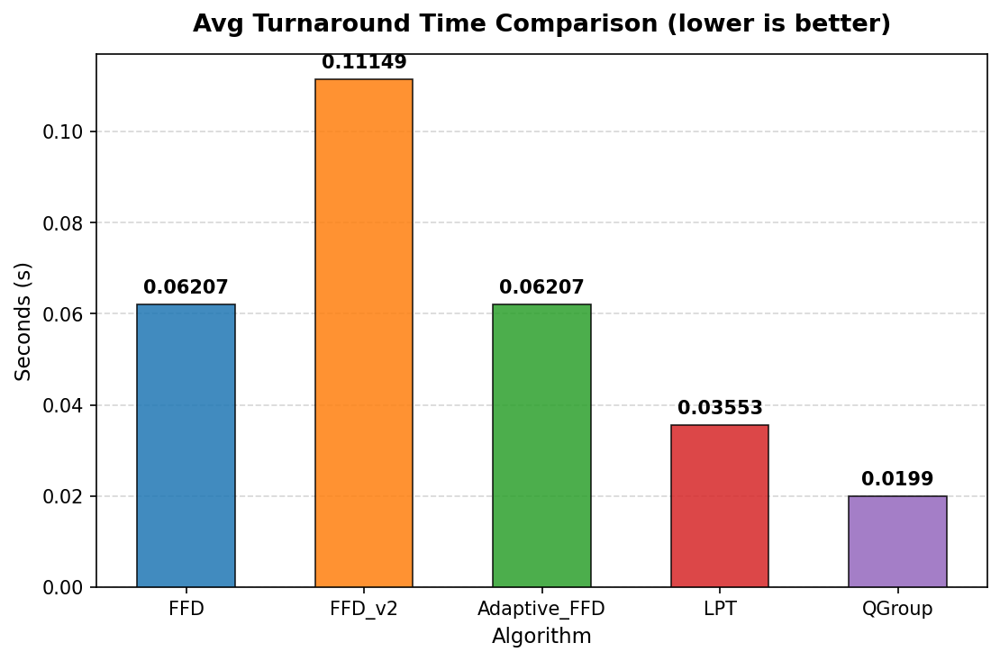
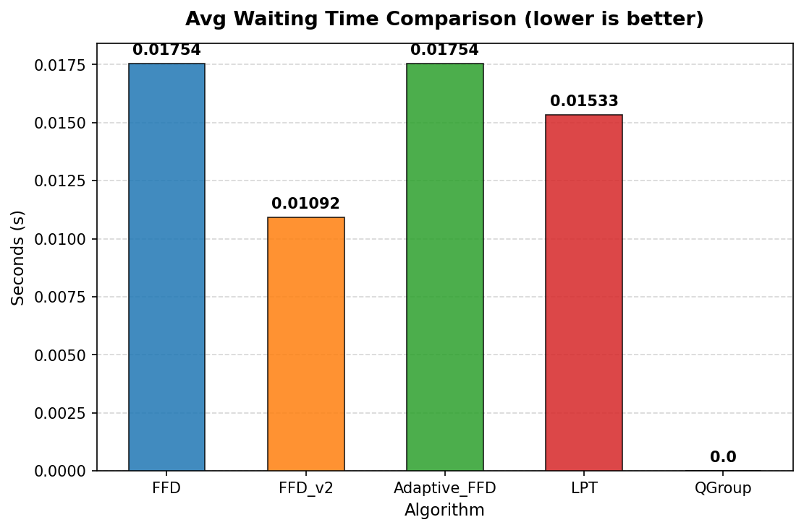
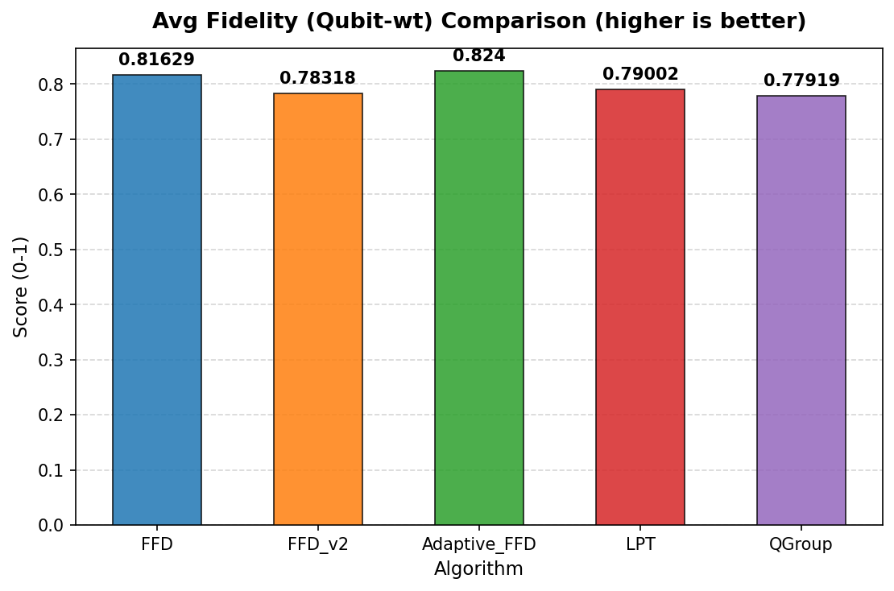
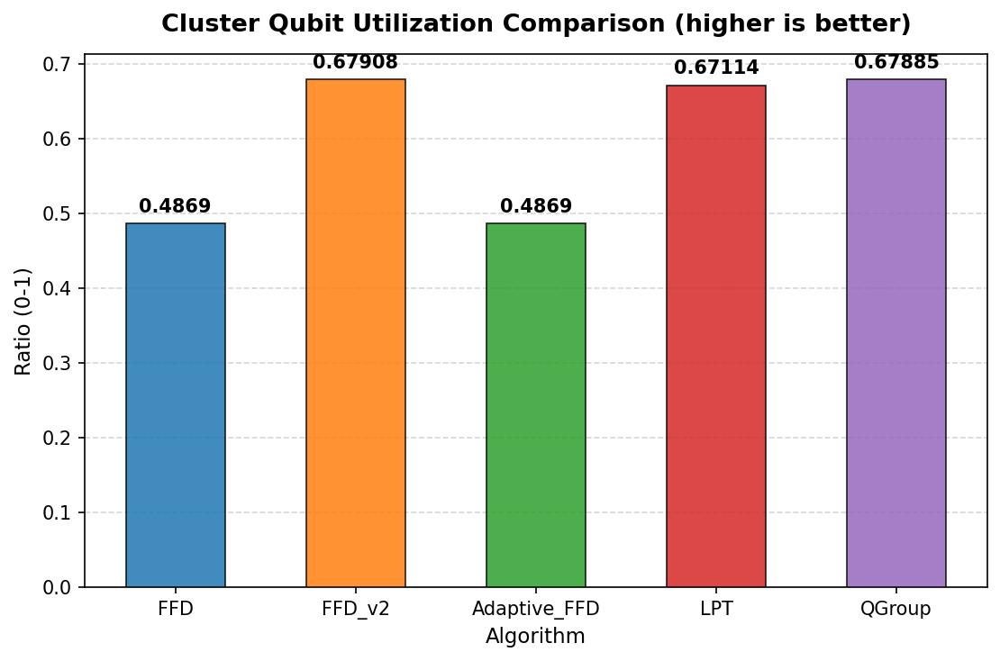
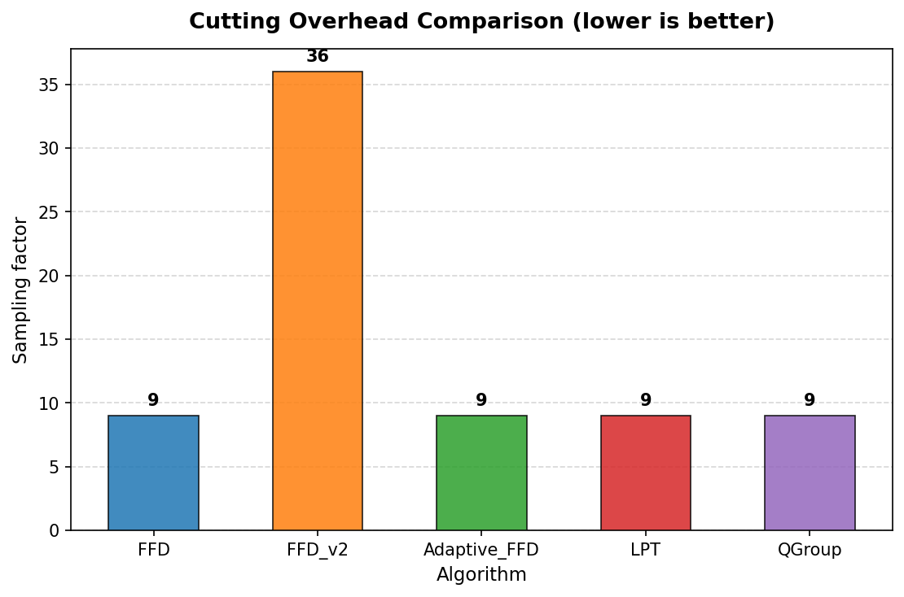
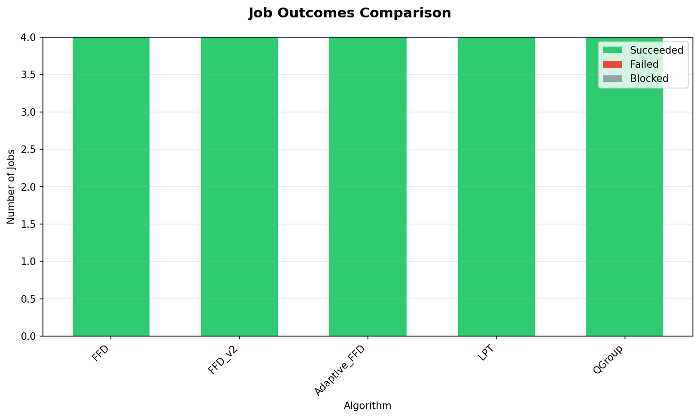
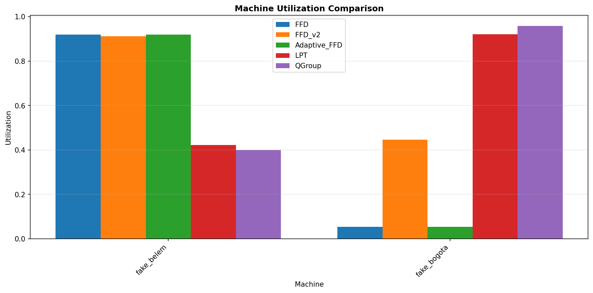

# Quantum Scheduling Batch Results Comparison

## Execution Status

| Algorithm | Status | Error |
|-----------|--------|-------|
| FFD | ✅ SUCCESS |  |
| FFD_v2 | ✅ SUCCESS |  |
| Adaptive_FFD | ✅ SUCCESS |  |
| LPT | ✅ SUCCESS |  |
| QGroup | ✅ SUCCESS |  |

## Workload and Configuration

- **Circuits**: 4 (ghz)
- **Average Qubits**: 3.5
- **Machines**: ["fake_belem", "fake_bogota"]
- **Queue / Backfill Policy**: strict
- **Baseline Algorithm**: FFD

### Circuit Cutting Configurations

| Algorithm | Mandatory Cut (Exceed) | Optional Cut (Remaining) |
|-----------|------------------------|-------------------------|
| FFD | greedy | Disabled (exceed only) |
| FFD_v2 | greedy | Enabled (algorithm_defined) |
| Adaptive_FFD | greedy | Disabled (exceed only) |
| LPT | greedy | Disabled (exceed only) |
| QGroup | greedy | Disabled (exceed only) |

## Scheduling Latency (wall-clock)

| Algorithm | Latency (s) | Difference from baseline |
|-----------|-------------|-------------------------|
| FFD | 1.938e-04 | baseline |
| FFD_v2 | 0.01708 | +0.01688 |
| Adaptive_FFD | 2.277e-04 | +3.389e-05 |
| LPT | 1.545e-04 | -3.925e-05 |
| QGroup | 0.01337 | +0.01318 |

## Execution Summary Metrics

All times in seconds (virtual execution time) unless specified otherwise.

| Metric | FFD | FFD_v2 | Adaptive_FFD | LPT | QGroup |
|--------|--------|--------|--------|--------|--------|
| Schedule Latency | 1.938e-04 | 0.01708 (+0.01688, +8713.01%) | 2.277e-04 (+3.389e-05, +17.49%) | 1.545e-04 (-3.925e-05, -20.26%) | 0.01337 (+0.01318, +6801.72%) |
| Makespan | 0.11771 | 0.12526 (+0.00755, +6.42%) | 0.11771 (0.0, 0.00%) | 0.06186 (-0.05585, -47.45%) | 0.06101 (-0.0567, -48.17%) |
| Avg Turnaround Time | 0.06207 | 0.11149 (+0.04942, +79.63%) | 0.06207 (0.0, 0.00%) | 0.03553 (-0.02654, -42.76%) | 0.0199 (-0.04217, -67.94%) |
| Avg Waiting Time | 0.01754 | 0.01092 (-0.00662, -37.76%) | 0.01754 (0.0, 0.00%) | 0.01533 (-0.00221, -12.61%) | 0.0 (-0.01754, -100.00%) |
| Avg Fidelity (Qubit-wt) | 0.81629 | 0.78318 (-0.03311, -4.06%) | 0.824 (+0.0077, +0.94%) | 0.79002 (-0.02628, -3.22%) | 0.77919 (-0.0371, -4.55%) |
| Cluster Qubit Utilization | 0.4869 | 0.67908 (+0.19218, +39.47%) | 0.4869 (0.0, 0.00%) | 0.67114 (+0.18424, +37.84%) | 0.67885 (+0.19195, +39.42%) |
| Cutting Overhead | 9 | 36 (+27, +300.00%) | 9 (0.0, 0.00%) | 9 (0.0, 0.00%) | 9 (0.0, 0.00%) |

**Metric Definitions:**

- **Schedule Latency**: Wall-clock scheduling decision time (s)
- **Makespan**: Total virtual execution time (s)
- **Avg Turnaround Time**: Mean turnaround time across jobs (s)
- **Avg Waiting Time**: Mean actual waiting time in queue (s)
- **Avg Fidelity (Qubit-wt)**: Mean quantum circuit fidelity weighted by circuit qubits
- **Cluster Qubit Utilization**: Qubit space-time allocation over total cluster capacity * makespan
- **Cutting Overhead**: Total sampling overhead incurred from circuit cutting

**Note**: Values in parentheses show (difference from baseline, % change)

## Job Outcomes

| Algorithm | Succeeded | Failed | Blocked | Total |
|-----------|-----------|--------|---------|-------|
| FFD | 4 | 0 | 0 | 4 |
| FFD_v2 | 4 | 0 | 0 | 4 |
| Adaptive_FFD | 4 | 0 | 0 | 4 |
| LPT | 4 | 0 | 0 | 4 |
| QGroup | 4 | 0 | 0 | 4 |

## Machine Utilization

| Machine | FFD Util | FFD_v2 Util | Adaptive_FFD Util | LPT Util | QGroup Util | FFD Busy Time | FFD_v2 Busy Time | Adaptive_FFD Busy Time | LPT Busy Time | QGroup Busy Time |
|---|---|---|---|---|---|---|---|---|---|---|
| fake_belem | 0.9192 | 0.9120 | 0.9192 | 0.4218 | 0.3998 | 0.12s | 0.13s | 0.12s | 0.06s | 0.05s |
| fake_bogota | 0.0546 | 0.4461 | 0.0546 | 0.9205 | 0.9579 | 0.01s | 0.06s | 0.01s | 0.06s | 0.06s |

**Note**: Utilization measures logical qubit allocation over capacity * makespan.

## Batch Execution Records

### FFD Batches

Total batches: 3

| Batch | Machine | Jobs | Shots | Start | End | Duration | Status |
|-------|---------|------|-------|-------|-----|----------|--------|
| 1 | fake_belem | 1 | 1024 | 0.00s | 0.07s | 0.07s | SUCCEEDED |
| 2 | fake_bogota | 2 | 1024 | 0.00s | 0.01s | 0.01s | SUCCEEDED |
| 3 | fake_belem | 2 | 1024 | 0.07s | 0.12s | 0.05s | SUCCEEDED |

### FFD_v2 Batches

Total batches: 3

| Batch | Machine | Jobs | Shots | Start | End | Duration | Status |
|-------|---------|------|-------|-------|-----|----------|--------|
| 1 | fake_belem | 1 | 1024 | 0.00s | 0.07s | 0.07s | SUCCEEDED |
| 2 | fake_bogota | 3 | 1024 | 0.00s | 0.06s | 0.06s | SUCCEEDED |
| 3 | fake_belem | 4 | 1024 | 0.07s | 0.13s | 0.06s | SUCCEEDED |

### Adaptive_FFD Batches

Total batches: 3

| Batch | Machine | Jobs | Shots | Start | End | Duration | Status |
|-------|---------|------|-------|-------|-----|----------|--------|
| 1 | fake_belem | 1 | 1024 | 0.00s | 0.07s | 0.07s | SUCCEEDED |
| 2 | fake_bogota | 2 | 1024 | 0.00s | 0.01s | 0.01s | SUCCEEDED |
| 3 | fake_belem | 2 | 1024 | 0.07s | 0.12s | 0.05s | SUCCEEDED |

### LPT Batches

Total batches: 5

| Batch | Machine | Jobs | Shots | Start | End | Duration | Status |
|-------|---------|------|-------|-------|-----|----------|--------|
| 1 | fake_belem | 1 | 1024 | 0.00s | 0.01s | 0.01s | SUCCEEDED |
| 2 | fake_bogota | 1 | 1024 | 0.00s | 0.05s | 0.05s | SUCCEEDED |
| 3 | fake_belem | 1 | 1024 | 0.01s | 0.01s | 0.01s | SUCCEEDED |
| 4 | fake_belem | 1 | 1024 | 0.01s | 0.06s | 0.05s | SUCCEEDED |
| 5 | fake_bogota | 1 | 1024 | 0.05s | 0.06s | 0.01s | SUCCEEDED |

### QGroup Batches

Total batches: 4

| Batch | Machine | Jobs | Shots | Start | End | Duration | Status |
|-------|---------|------|-------|-------|-----|----------|--------|
| 1 | fake_belem | 2 | 1024 | 0.00s | 0.01s | 0.01s | SUCCEEDED |
| 2 | fake_bogota | 1 | 1024 | 0.00s | 0.01s | 0.01s | SUCCEEDED |
| 3 | fake_belem | 1 | 1024 | 0.01s | 0.05s | 0.05s | SUCCEEDED |
| 4 | fake_bogota | 1 | 1024 | 0.01s | 0.06s | 0.05s | SUCCEEDED |

## Visualizations

### Overview Metrics Comparison

### Individual Metric Comparisons

#### Schedule Latency

#### Makespan

#### Avg Turnaround Time

#### Avg Waiting Time

#### Avg Fidelity (Qubit-wt)

#### Cluster Qubit Utilization

#### Cutting Overhead

### Job Outcomes

### Machine Utilization

